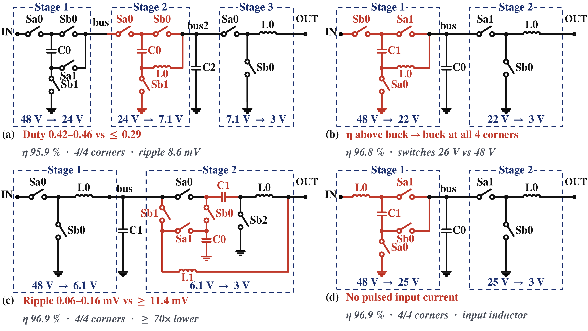

# Multi-stage 48 V → 3 V converters found by Delta-Seeker

This folder holds four converter topologies found by our AI search (Delta-Seeker, DAC paper, figure `figures/fig_conv_stages.png`). It includes the netlists, a simulator wrapper that reproduces every number in the figure, ready-to-run ngspice decks, and the textbook reference circuits for comparison.

**Your task:** understand how each circuit works, check that its claimed advantage is real and robust, and find out what each added part (red in the figure) actually does.



---

## 1. Specification (the bench)

| | |
|---|---|
| Conversion | 48 V → 3 V at 10 A (30 W), 16:1 step-down (48 V bus to point of load) |
| Load | R = 0.3 Ω, Cout = 47 µF (ESR 2 mΩ) |
| Switching | 500 kHz, **one shared duty D for every switch**, D limited to [0.1, 0.9] |
| Switches | ideal ngspice `SW`, Ron = 5 mΩ, Roff = 1 MΩ, **no switching-loss model** |
| Passives | every L = 2.2 µH, every C = 47 µF; ESR 2 mΩ; inductor DCR 2 mΩ × (number of inductors) per inductor ("equal copper": total copper is fixed) |
| Switch rating | peak \|Vds\| ≤ 60 V |
| Pass rule | Vout within ±5 % of 3 V, ripple ≤ 5 % of Vout, η ≥ 90 %, rating met, **at all 4 corners** |
| Corners | 0 nominal · 1 heavy load (R/2) · 2 light load (2R) · 3 low line (Vin −10 %) with all L and C −20 % |

At each corner the duty is searched (sweep 0.1/0.3/…/0.9, then secant refinement toward 3 V), and the best-efficiency passing point is reported. This mirrors a regulated converter.

**Switch naming.** `Sa*` switches are ON for D·T (phase A). `Sb*` switches are ON for (1−D)·T (phase B, the complement). The suffix `s1/s2/s3` is the stage, and `BUS1/BUS2` are the buses between stages. `IN` = 48 V and `0` = ground.

---

## 2. Folder layout

```
README.md
figures/        fig_conv_stages.{png,pdf} (the paper figure), fig_conv_compact.{png,pdf} (same circuits, no stage boxes)
netlists/       a_F57.net b_F9.net c_F7.net d_F8.net   <- the 4 designs, exactly as simulated for the figure
                ref_sc2_buck.net ref_sc4_buck.net ref_buck_buck.net ref_buck.net  <- textbook references
netlists/reduced/   same 4 designs after our automatic redundancy stripping (FYI only, not used for the numbers)
spice/          ready ngspice decks: <design>_<corner>.cir at the duty the search picked (run directly with ngspice)
tools/run_design.py   main script: corners, duty search, decks, waveforms, removal tests
tools/plot_waves.py   plot a waveform dump
tools/bench.py, tools/spec.py   the simulator bench, copied UNCHANGED from the search code
results/all_corners.json      all designs × all corners (re-generated here 11/16, matches the paper numbers)
results/waves/                example waveform dump + plot for design (c)
provenance/     original data records, problem definition, and the figure script (for traceability only)
```

**Requirements:** `python3` (stdlib only) and `ngspice` on PATH (tested with ngspice-36, Python 3.10). `plot_waves.py` also needs `numpy` and `matplotlib`.

---

## 3. Quick start

Run from inside this folder:

```bash
# one design, 4 corners (~10 s per corner)
python3 tools/run_design.py netlists/c_F7.net

# everything (designs + references), saved to JSON
python3 tools/run_design.py netlists/*.net --json results/all_corners.json --workers 16

# run a deck straight in ngspice (prints the measured vout/pin/pout/ripple/|Vds|)
ngspice -b spice/c_F7_nominal.cir

# waveforms (last 20 periods: every node voltage, every inductor and capacitor current, input current) + plot
python3 tools/run_design.py netlists/c_F7.net --corner 0 --waves results/waves/waves
python3 tools/plot_waves.py results/waves/waves_c_F7_nominal.txt --periods 4

# removal tests: delete a device (open circuit) or replace it by a wire
python3 tools/run_design.py netlists/c_F7.net --corner 0 --remove L1s2
python3 tools/run_design.py netlists/c_F7.net --corner 0 --short  C1s2

# fixed duty (no duty search), e.g. for sweeps you script yourself
python3 tools/run_design.py netlists/c_F7.net --corner 0 --duty 0.13
```

**Capacitor current probes.** Every deck in `spice/` measures the current of each capacitor (including `Cout`) over the last 20 periods, named by its netlist device. Run a deck directly to read them:

```bash
ngspice -b spice/a_F57_nominal.cir | grep '^ic_'
# ic_c0s2_rms = 3.39   ic_c0s2_max = 4.79   ic_c0s2_min = -10.6   (stage-2 flying cap C0s2, amps)
```

The probes are the `meas tran ic_<device>_{rms,max,min} ... @cN[i]` lines at the end of each deck (`save all @c1[i] ...` sits above `tran`). To probe something else, add a line in the same form, e.g. `meas tran il1_rms RMS @l1[i] from=0.00396 to=0.004`. For the full waveform, use `--waves` + `plot_waves.py` above; the plot has a capacitor-current panel.

**Names in decks and waveforms.** `bench.py` renumbers devices: switches become S1, S2, …, inductors L1, L2, … and capacitors C1, C2, … in netlist order. Every internal node gets an `n` prefix (`BUS1` → `nBUS1`, `s2n12` → `ns2n12`), with `IN` → `VIN` and `OUT` → `VOUT`. Each deck's header lists the exact device map, e.g. `L1s2->L3`, so `@l3[i]` in the waveform file is the current in `L1s2`. Inductor and capacitor currents (`@lN[i]`, `@cN[i]`) are positive from the netlist's first node to its second; `--waves` also writes a `.map.json` next to the dump so `plot_waves.py` labels each trace with its netlist name.

---

## 4. The four designs

Each design's numbers are at the nominal corner, with the worst corner in brackets. "Red" lists the parts drawn in red in the figure, using the netlist names. Note that the figure's labels sometimes differ from the netlist names; the netlist names below are the ones to use.

### (a) `a_F57.net`: 2:1 switched-capacitor → flying-capacitor hybrid → buck (3 stages)
- Stage 1, `s1`: classic 2:1 SC (48 → 24 V). Stage 2, `s2`: hybrid (24 → 7.1 V). Stage 3, `s3`: buck (7.1 → 3 V).
- **Red (stage 2):** `Sa0s2, Sb0s2, C0s2, Sb1s2, L0s2`
- The netlist also has a bus capacitor `C1s1` on BUS1, which the figure does not draw.
- η 95.92 % (92.13 %), D = 0.425, ripple 8.6 mV, max \|Vds\| 24 V
- **Claim:** duty 0.42–0.46, vs ≤ 0.29 for every textbook circuit that meets the spec. A larger duty avoids very short on-times.

### (b) `b_F9.net`: flying-capacitor hybrid → buck (2 stages)
- **Red (stage 1):** `Sb0s1, Sa1s1, C1s1, L0s1, Sa0s1` (`C0s1` is the bus capacitor)
- η 96.86 % (93.97 %), D = 0.144, ripple 14.1 mV, max \|Vds\| 26 V
- **Claim:** efficiency above buck→buck at all 4 corners, with switches seeing 26 V vs 48 V for buck→buck.

### (c) `c_F7.net`: buck → series-capacitor dual-inductor stage (2 stages)
- **Red (stage 2):** `Sb1s2, Sa1s2, Sb0s2, C0s2, C1s2, L1s2` (black in stage 2: `Sa0s2, Sb2s2, L0s2`; `Cbus1` is the bus capacitor)
- η 97.00 % (94.32 %), D = 0.128, **ripple 0.06–0.16 mV** vs ≥ 11.4 mV for every reference, max \|Vds\| 48 V
- **Claim:** at least 70× lower output ripple. In `results/waves/waves_c_F7_nominal.png` the two output inductor currents (`L0s2`, `L1s2` = `@l2`, `@l3`) ramp with equal and opposite slopes, so their ripple cancels at the output.

### (d) `d_F8.net`: current-fed (input inductor) hybrid → buck (2 stages)
- **Red (stage 1):** `L0s1, Sa1s1, C1s1, Sb0s1, Sa0s1` (`C0s1` is the bus capacitor)
- η 96.90 % (94.04 %), D = 0.119, ripple 14.0 mV, max \|Vds\| 25.6 V
- **Claim:** no pulsed input current, because the inductor is in series with the input.

### References (same bench, `results/all_corners.json`)

| circuit | η nominal (worst) | D | ripple | max \|Vds\| | passes |
|---|---|---|---|---|---|
| ref_sc2_buck (2:1 SC → buck) | **97.50 % (95.14)** | 0.128 | 13.9 mV | 24 V | 4/4 |
| ref_sc4_buck (4:1 SC → buck) | 97.06 % (94.25) | 0.257 | 11.5 mV | 24 V | 4/4 |
| ref_buck_buck | 96.57 % (93.66) | 0.252 | 11.5 mV | 48 V | 4/4 |
| ref_buck (single buck) | — | needs D ≈ 0.06 < 0.1 | | | 0/4 |

> **Be aware:** none of the four designs beats `ref_sc2_buck` on efficiency. Each design's claim is about one other property: duty, switch stress, ripple or input current. Keep the claims at that level. Design (c) also needs 48 V switches, while the SC-based references need only 24 V.

---

## 5. What to analyse (suggested order)

1. **Reproduce.** Run `python3 tools/run_design.py netlists/*.net` and check that you get the tables above.
2. **How does each one work?** For each design, dump waveforms at the nominal corner and explain them per phase (A: 0…D·T, B: D·T…T):
   - which switches conduct
   - each flying capacitor's average voltage and charge balance
   - each inductor's volt-second balance
   - each bus voltage

   Derive the voltage-conversion ratio M(D) by hand and compare it with a duty sweep (`--duty`). One example of the expected answer: in (b), the input switch `Sb0s1` is on for (1−D)·T, and stage 1 appears to give V_BUS1 ≈ (1−D)/(2−D)·Vin (≈ 22 V at D = 0.144, which matches the figure). Derive it properly and check it against a sweep.
3. **What do the red parts do?** For each red device:
   - `--remove` it, and also `--short` it where that makes sense
   - re-run all 4 corners
   - record whether the circuit still converts, and what happens to η, ripple and \|Vds\|

   Also replace the whole red stage with its textbook counterpart (e.g. a buck or a 2:1 SC) and compare.

   A part whose removal changes nothing is redundant. That was the criticism of our earlier designs: one looked like an LC notch filter added to a plain buck.
4. **Are the claims robust?**
   - (c) The ripple cancellation relies on two identical inductors, and the tolerance corner scales all L together. Test a **mismatch** between `L0s2` and `L1s2` (e.g. ±10–20 %; edit `bench.py` or the `.cir` deck) and duty values away from 0.128.
   - (a) Check the duty advantage across Vin.
   - (b) and (d) Check that the stress and input-current claims hold at all corners.
5. **Is it known?** Compare each red block against the literature: hybrid switched-capacitor converters, series-capacitor buck, interleaved / two-phase buck, current-fed converters, and three-level buck. The paper's safest framing is "known-good blocks composed into multi-stage chains with a measurable advantage". Tell us if any block is actually a published topology, with a reference.
6. **Bench limits (stay aware):** ideal switches, no switching or gate-drive loss, no dead time, a single shared duty, fixed component values (no per-part sizing), and no capacitor inrush or start-up analysis. If time allows, adding switching loss (e.g. ½·V·I·t_sw·f_sw per switch) would show whether the efficiency ranking survives.

Please put what you produce in a new folder under `results/`, e.g. `results/mayowa_<topic>/`, and do not edit `tools/bench.py`, `tools/spec.py` or `netlists/` in place. Copy them if you need to modify them, so the original numbers stay reproducible.

---

## 6. Provenance (for traceability, not needed to run)

- The search code is `Deltaseeker_dpo/rsi_v6/protocol_v90`. `bench.py` and `spec.py` come from `protocol_v90/converter/`, and the problem definition is `provenance/problem_v90.json`.
- Netlists come from `provenance/final_all48_1114.json` (the `core` field), records 129 / 28 / 24 / 27 = designs a / b / c / d. They were found by search runs V90R_1/s4, V90_3/s2, V90_8/s3 and V90_3/s2 respectively.
- The paper's corner numbers are in `provenance/corners_reference_1114.json`. The re-run in `results/all_corners.json` matches them.
- The figure script is `provenance/make_fig_conv_compact.py`. It only runs inside the original repo, and it draws the circuits by hand from the netlists.

---

## Modifications on 11_25 (capacitor current probes)

- **Probes added to every deck in `spice/`.** Each capacitor's current is measured (RMS, max, min), named by its netlist device (e.g. `ic_c0s2_rms`). The probes are the `meas tran ic_...` lines at the end of each `.cir` file; the code that writes them is in `tools/run_design.py` (function `deck_text`).
- **How to run:**
  ```bash
  ngspice -b spice/a_F57_nominal.cir | grep '^ic_'
  ```
- **Waveform figures with capacitor currents** (bottom panel): `results/waves/waves_a_F57_nominal.png`, `results/waves/waves_b_F9_nominal.png`.
